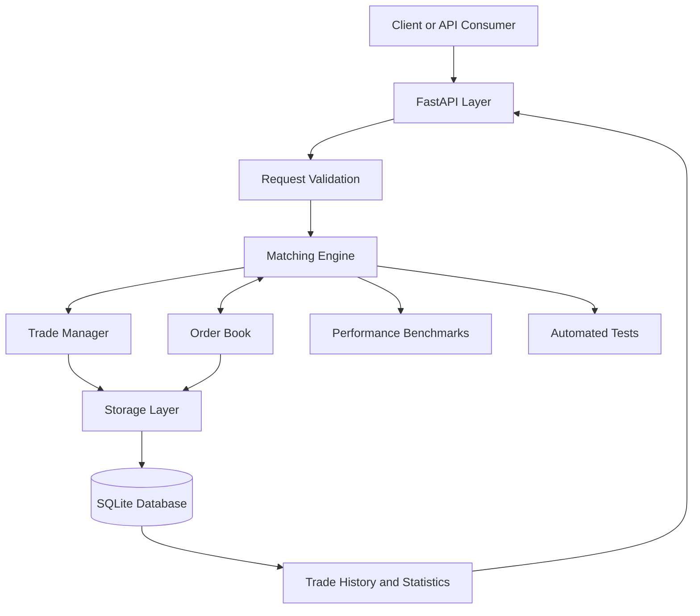

# ChronosMatch — System Architecture

## 1. Overview

ChronosMatch is a Python-based trading engine prototype designed to simulate the processing and matching of buy and sell orders. The system focuses on efficient order-book management, price-time priority, trade execution, testing, and performance measurement.

The architecture uses modular components so that the matching engine can operate independently of the API, database, and optional dashboard.

The initial version will use simulated orders and will not connect to a real exchange or execute actual financial transactions.

## 2. Architectural Goals

- Develop a modular and maintainable Python application.
- Process orders using well-defined matching rules.
- Support partial fills, order cancellation, and trade recording.
- Separate core business logic from API and storage layers.
- Enable automated testing and repeatable performance benchmarks.
- Investigate zero-copy optimization techniques where appropriate.
- Keep the design simple enough to complete and demonstrate within the internship period.

## 3. High-Level Architecture

The system consists of the following components:

1. **Client Layer:** Sends order requests and retrieves order information.
2. **API Layer:** Receives requests, validates input, and returns responses.
3. **Order Validation:** Checks symbols, order sides, prices, and quantities.
4. **Matching Engine:** Processes valid orders and identifies compatible orders.
5. **Order Book:** Maintains active buy and sell orders.
6. **Trade Manager:** Records executions and updates order quantities and statuses.
7. **Storage Layer:** Persists order and trade information when configured.
8. **Testing and Benchmarking:** Verifies correctness and measures performance.

## 4. Architecture Diagram



The diagram represents the proposed logical architecture. Automated tests and benchmarks may invoke the engine directly without going through the API.

## 5. Component Responsibilities

### 5.1 Client Layer

The client layer represents a user, test script, or optional dashboard interacting with the engine.

Responsibilities:
- Submit buy and sell orders.
- Retrieve order status and trade history.
- View the current order book and performance statistics.

### 5.2 API Layer

FastAPI provides HTTP endpoints for accessing the engine.

Proposed endpoints:

- `POST /orders` — Submit an order.
- `GET /orders/{order_id}` — Retrieve order details.
- `DELETE /orders/{order_id}` — Request order cancellation.
- `GET /orderbook/{symbol}` — Retrieve the order book for a symbol.
- `GET /trades` — Retrieve trade history.
- `GET /stats` — Retrieve available engine statistics.
- `GET /health` — Check service health.

The API layer should not contain the core matching algorithm. It should validate requests and delegate business operations to the engine.

### 5.3 Request Validation

The validation component checks that incoming orders contain valid fields and values.

Examples:
- Order quantity must be positive.
- Order price must be positive.
- Order side must be BUY or SELL.
- The trading symbol must be valid according to the project's configured rules.

Invalid requests should be rejected with clear error messages.

### 5.4 Matching Engine

The matching engine is the central component of ChronosMatch.

Responsibilities:
- Receive validated orders.
- Locate compatible opposing orders.
- Apply price-time priority.
- Execute full or partial matches.
- Update remaining quantities and order statuses.
- Send execution information to the trade manager.

For this prototype, a buy order is compatible with a sell order when both use the same symbol and the buy limit price is greater than or equal to the sell limit price.

The initial implementation will use the resting order's price as the execution price. This is a documented design choice for the prototype and may be revised if the team agrees on another rule.

### 5.5 Order Book

The order book stores active orders that have not been completely filled or cancelled.

It maintains:
- Buy orders, prioritizing higher prices.
- Sell orders, prioritizing lower prices.
- Time priority among orders at the same price.
- Remaining quantities for partially filled orders.
- Separate order books for different symbols.

The initial implementation should prioritize correctness and predictable behavior. More advanced data structures can be evaluated after establishing a working baseline.

### 5.6 Trade Manager

The trade manager handles the records generated by successful matches.

Responsibilities:
- Generate a unique identifier for each trade.
- Record the matched buy and sell order IDs.
- Store execution price and quantity.
- Maintain consistent order quantities and statuses.
- Make trade history available to the API.

A trade must not be recorded for an order quantity that was not actually executed.

### 5.7 Storage Layer

SQLite is the proposed persistence option for the initial prototype.

It may store:
- Order records.
- Trade records.
- Execution details.
- Relevant timestamps and status information.

The storage layer should be separate from the matching algorithm so that the engine can be tested independently. Persistence behavior and transaction boundaries must be designed carefully to avoid inconsistent records.

### 5.8 Testing and Benchmarking

The project will include:
- Unit tests for order validation and matching.
- Tests for partial fills and cancellation.
- Tests for price-time priority.
- Tests for separate symbols.
- Integration tests for API behavior.
- Benchmarks for latency and throughput.
- Profiling to identify performance bottlenecks.

Zero-copy techniques will be evaluated only where suitable. Performance improvements must be supported by measurements under documented test conditions.

## 6. Proposed Technology Stack

| Component | Technology |
|---|---|
| Programming language | Python |
| API framework | FastAPI |
| Request validation | Pydantic |
| Database | SQLite |
| Automated testing | pytest |
| Version control | Git and GitHub |
| Profiling | cProfile |
| Timing measurements | time.perf_counter_ns |
| Optional dashboard | Streamlit |

These are proposed implementation choices, not technologies mandated by the internship assignment.

## 7. Proposed Project Structure

```text
ChronosMatch/
├── app/
│   ├── main.py
│   ├── api/
│   │   └── routes.py
│   ├── engine/
│   │   ├── models.py
│   │   ├── order_book.py
│   │   └── matching_engine.py
│   ├── schemas/
│   │   └── orders.py
│   └── storage/
│       └── database.py
├── tests/
│   ├── test_order_book.py
│   ├── test_matching_engine.py
│   └── test_api.py
├── benchmarks/
│   └── benchmark_engine.py
├── docs/
│   ├── requirements.md
│   ├── team-responsibilities.md
│   └── architecture.md
├── requirements.txt
├── README.md
└── .gitignore
```

This structure is a proposed target. Create files as their corresponding features are implemented rather than creating empty implementation files solely to match the diagram.

## 8. Order Processing Workflow

1. A client submits an order through the API.
2. The API validates the request.
3. The matching engine receives the valid order.
4. The engine checks the opposing order book for compatible orders.
5. Compatible orders are matched according to price-time priority.
6. Executed quantities are recorded as trades.
7. Remaining quantities and order statuses are updated.
8. Any unfilled remainder is added to the appropriate order book if the order is eligible to rest.
9. Order and trade information is persisted when storage is enabled.
10. The API returns the resulting order status and relevant execution information.

## 9. Performance and Zero-Copy Strategy

The project aims to explore efficient data handling and minimize unnecessary copying where practical.

The strategy is:

1. Implement a correct, readable baseline.
2. Create repeatable benchmarks.
3. Measure latency and throughput under documented conditions.
4. Profile the application to identify actual bottlenecks.
5. Evaluate targeted optimizations.
6. Compare optimized results with the baseline.
7. Document any improvements and their limitations.

Using a technique or data structure described as zero-copy does not automatically make the entire system zero-copy. Any performance claims must be supported by measurements.

## 10. Design Limitations

The initial architecture is intended for a simulated trading engine prototype.

It does not guarantee:
- Production exchange performance.
- Production-grade fault tolerance.
- Distributed order matching.
- Real exchange connectivity.
- Real-money trade execution.
- Strict zero-copy behavior across every component.

These limitations can be revisited if the project scope changes and sufficient development time is available.

## 11. Future Improvements

Potential future improvements include:
- More efficient order-book data structures.
- Improved memory allocation and data-copy behavior.
- Additional performance and load tests.
- More detailed metrics and a dashboard.
- Stronger persistence and recovery mechanisms.
- Further concurrency evaluation after the single-threaded engine is correct.

## 12. Conclusion

ChronosMatch uses a modular architecture that separates request handling, order matching, trade management, persistence, and performance evaluation.

The implementation will prioritize correctness, clear interfaces, testability, and measurable performance improvements. The architecture may be updated as the team implements the system and receives mentor feedback.